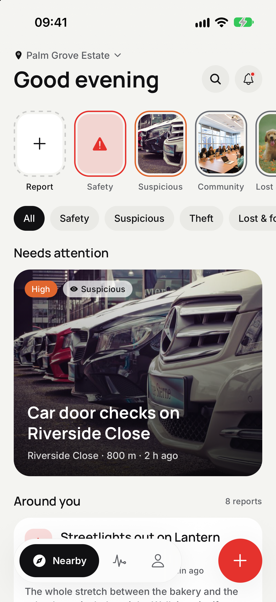
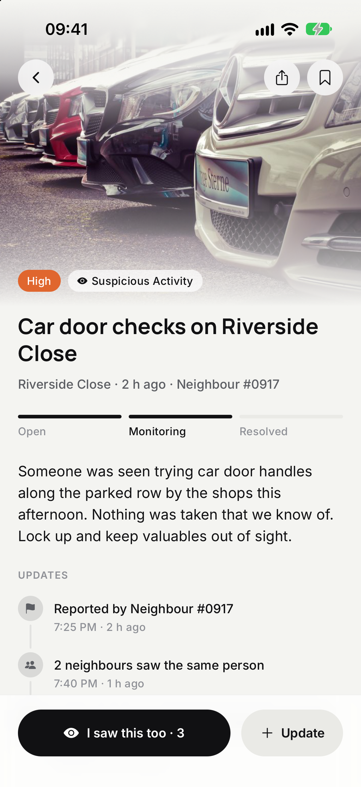
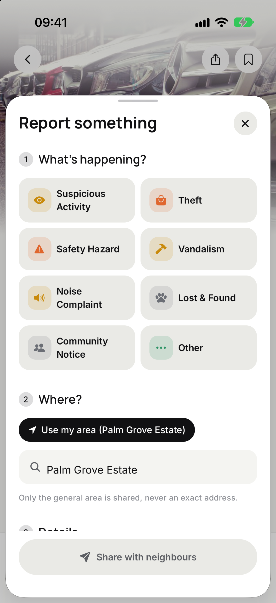
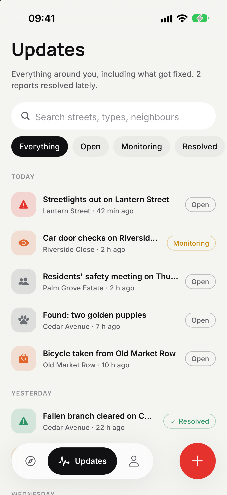
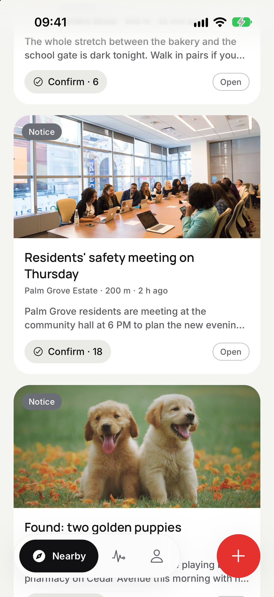
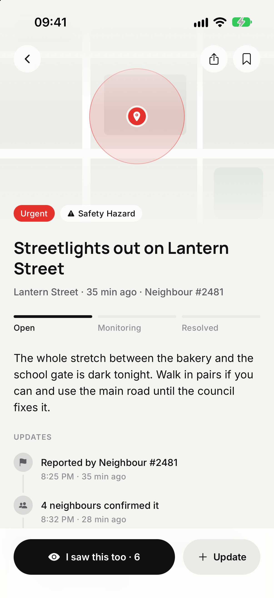
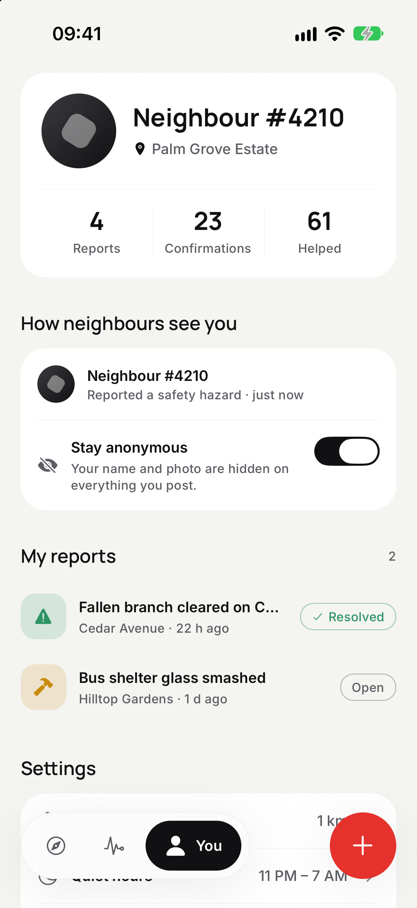

# Alarmiti

A concept UI for a neighbourhood-watch app: what's happening nearby, a quick way to report something, and a profile that lets you stay anonymous.

> **UI only.** There is no backend, account system or network API. Every screen runs on local sample data and bundled photos, and anything you add (a report, a confirmation, a name, a photo) lives in memory until the app reloads. All neighbourhoods, handles and events are invented.

<p>
  
  
  
  
</p>

## Screens

| Screen | What it shows |
| --- | --- |
| **Nearby** (home) | A greeting with your neighbourhood, a **Nearby now** row of the latest open reports in severity-coloured rings, type filter chips, a hero card for the most pressing report with a photo, and a photo-first feed. **Confirm** on any card adds your "I saw this too". |
| **Incident details** | A full-bleed photo (or a drawn map of the general area), severity and category, an *Open → Monitoring → Resolved* status strip, a timeline of updates, the location card, and a sticky **I saw this too** action. Share and follow sit over the photo. |
| **Report** (sheet) | Opens from the **+** beside the tab bar. Three steps: what (a grid of types tinted by default severity), where (your area by default, or search), and details (description, photo, **Urgent** and **Post anonymously** toggles). Sharing closes the sheet with a haptic and a toast that opens the new report. |
| **Updates** | Everything around you, including what got fixed: search, status chips, and rows grouped under Today, Yesterday and weekday headers. |
| **You** (profile) | A generated avatar, stats, a preview of exactly how neighbours see you, the anonymous switch (turning it off asks for your name), your reports, and static settings rows. |

<p>
  
  
  
</p>

The redesign follows [docs/modernise.md](docs/modernise.md). Screenshots of the earlier design are in [docs/screenshots/before](docs/screenshots/before).

## Design system

- **Tokens** in [`theme/tokens.ts`](theme/tokens.ts): a light, monochrome palette where near-black is the accent and red is kept for alerts, five severity colours (Notice, Low, Medium, High, Urgent), a type scale (Manrope for headings, Inter for text), radii and spacing. Colour only shows up where it means something.
- **Primitives** in [`components/ui`](components/ui): `PressableScale` (press scale plus optional haptic, dimming instead of scaling under Reduce Motion), `Chip`, `IconButton`, `SeverityBadge`, `IconTile` and `SectionHeader`.
- **Incident components** in [`components/incident.tsx`](components/incident.tsx): hero card, feed card, list row, highlight tile, status tag and steps, confirm button and updates timeline.
- **Floating tab bar** in [`components/FloatingTabBar.tsx`](components/FloatingTabBar.tsx): a blurred pill whose active tab widens to show its label, with the Report button beside it.

## Stack

- Expo SDK 58, React Native 0.88, React 19.3, with the React Compiler on
- expo-router with typed routes, native form sheets
- Reanimated 4 for press feedback, tab and list animations
- expo-image, expo-image-picker, expo-blur, expo-linear-gradient, expo-haptics
- Manrope and Inter via `@expo-google-fonts`

The sample data is in [`data/sample.ts`](data/sample.ts), and the in-memory store the screens read from is in [`data/store.tsx`](data/store.tsx).

## Running it

```bash
npm install
npx expo run:ios
```

`expo run:ios` builds a development client and opens it on the iOS Simulator. `npx expo run:android` does the same for an Android emulator. The screenshots were taken on an iPhone 17 Simulator running iOS 27.

## Checks

```bash
npm run typecheck
npm run lint
```
