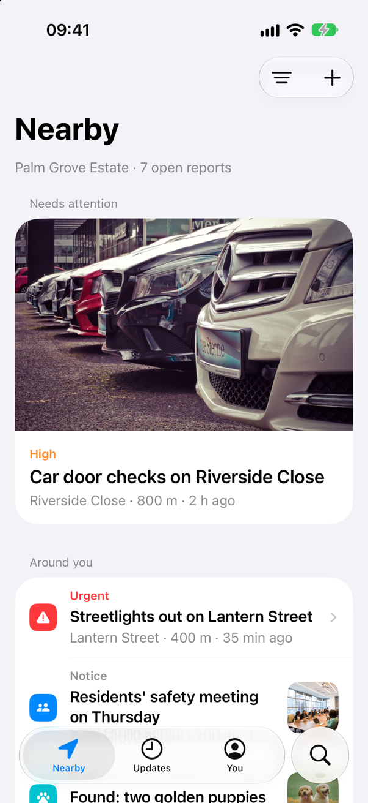
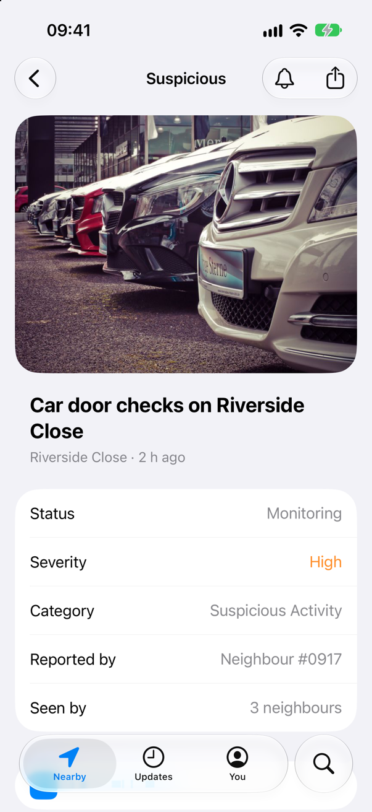
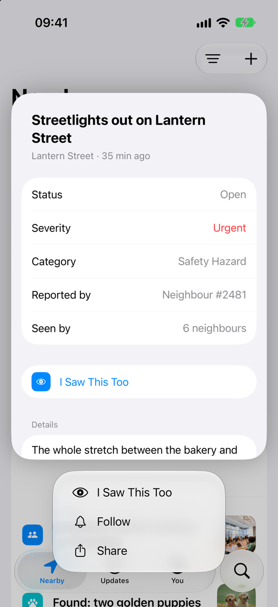
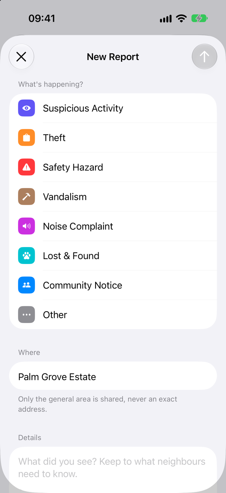
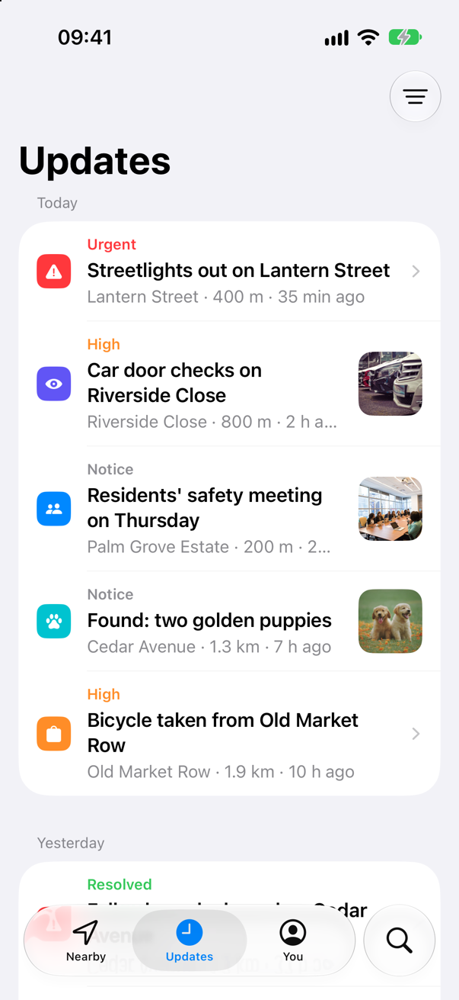
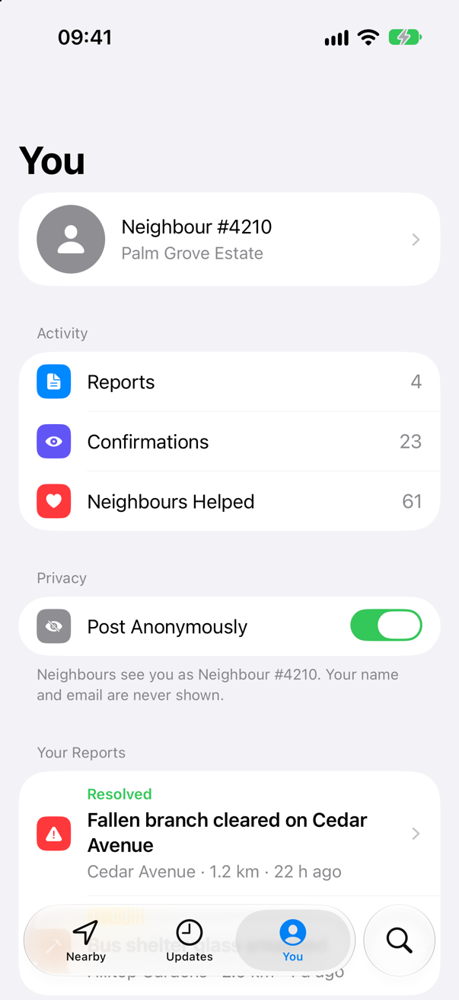
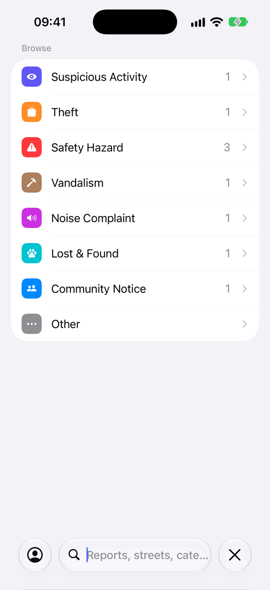
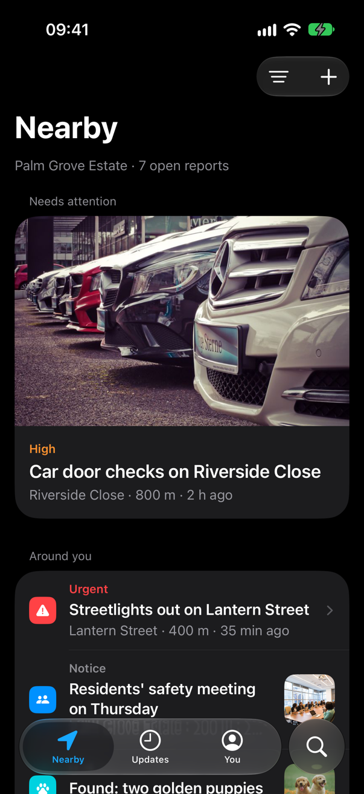

# Alarmiti

A concept UI for a neighbourhood-watch app on iOS: what's happening nearby, a quick way to report something, and a profile that lets you stay anonymous.

It's built to look and behave like an app Apple might ship. It uses the system tab bar with Liquid Glass, large titles, grouped lists, SF Symbols, system colours and the system font, so it follows light and dark mode and Dynamic Type on its own.

> **UI only.** There is no backend, account system or network API. Every screen runs on local sample data and bundled photos. Anything you add (a report, a confirmation, a photo) lives in memory until the app reloads. All neighbourhoods, handles and events are invented.

<p>
  
  
  
  
</p>

## Screens

| Screen | What it shows |
| --- | --- |
| **Nearby** | Your neighbourhood and how many reports are open, the most pressing report as a photo card, and a list of everything around you. The toolbar has a filter menu and a **+** for a new report. |
| **Incident** | Opens inside the tab you tapped it from. A photo when there is one, status, severity, category, who reported it and how many neighbours saw it, an **I Saw This Too** row, the description and a timeline of updates. Follow and Share sit in the navigation bar. |
| **Previews** | Long-press any report for a preview with **I Saw This Too**, **Follow** and **Share**. Tap the preview to open it. |
| **New Report** | A sheet with Cancel and Post in the navigation bar. Pick a type, where (your area by default), details and an optional photo, then switch on **Urgent** or **Post Anonymously**. Posting closes the sheet and opens the new report. |
| **Updates** | Every report, newest first, under Today, Yesterday and weekday headers. Filter by status from the toolbar. |
| **You** | A Settings-style profile: your photo and name, activity counts, the anonymous switch (switching it off asks for your name), your reports, your neighbourhood and urgent alerts. |
| **Search** | The separate search tab next to the tab bar. Browse by category, or search titles, streets and descriptions. |

<p>
  
  
  
  
</p>

Screenshots of the original app, before the concept, are in [docs/screenshots/before](docs/screenshots/before).

## How it's built

- **Native tabs** in [`app/(tabs)/_layout.tsx`](app/(tabs)/_layout.tsx) use `NativeTabs` from expo-router. This gives the system tab bar, which shrinks while you scroll, and a search tab of its own.
- **One stack shared by every tab** in [`app/(tabs)/(nearby,updates,you,search)`](<app/(tabs)/(nearby,updates,you,search)>). Each tab starts on its own screen, so incidents open inside the current tab and the tab bar stays put.
- **Header toolbars and search** come from `Stack.Toolbar` and `Stack.SearchBar`. Menus and buttons are native `UIBarButtonItem`s with SF Symbols.
- **Previews and menus** come from `Link.Preview` and `Link.Menu` in [`components/incidents.tsx`](components/incidents.tsx).
- **Lists** in [`components/list.tsx`](components/list.tsx): `Section`, `Row` and `IconTile`, drawn like Settings with rows that highlight while held and separators that start after the icon.
- **System styling** in [`theme/system.ts`](theme/system.ts): `PlatformColor` for every colour and Apple's text styles for type. There are no custom fonts and no hardcoded hex colours outside the theme.
- **Native controls** wherever iOS has one: `Switch`, action sheets, `Alert.prompt` for your name, the photo picker and the share sheet.

The sample data is in [`data/sample.ts`](data/sample.ts), and the in-memory store the screens read from is in [`data/store.tsx`](data/store.tsx).

## Stack

- Expo SDK 58, React Native 0.88, React 19.3, with the React Compiler on
- expo-router native tabs, toolbars, search bar and link previews
- expo-symbols for SF Symbols, expo-image, expo-image-picker, expo-haptics

## Running it

It needs a development build, because it uses native modules:

```bash
npm install
npx expo run:ios
```

It's designed for iOS 26. The screenshots were taken on an iPhone 17 Simulator running iOS 27.

## Checks

```bash
npm run typecheck
npm run lint
```
